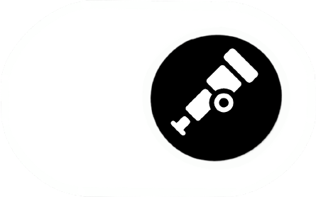



{: .mark}

KubeCon + CloudNativeCon North America 2026
{: .event}

# {{ site.talk_title }}

Controlling OpenTelemetry instrumentation at runtime with OpenFeature.

 × 
{: .partners}

[Get the slides]({{ site.slides_url }}){: .button} [Try the PoC on GitHub](https://github.com/OTelFeature/poc){: .button .secondary}
{: .actions}

**Missed a part?** [Watch the recording]({{ site.recording_url }}).**Missed a part?** KubeCon recordings go up on the [CNCF YouTube channel](https://www.youtube.com/@cncf) a few weeks after the event.

## Talk to us

Questions we didn't get to, want to try this in your own setup, or have opinions on the open questions? Reach out:

- [Open an issue on the poc repo](https://github.com/OTelFeature/poc/issues/new)
- Find us on the [CNCF Slack](https://slack.cncf.io) in `#openfeature` and `#opentelemetry`
- Through our websites: [Simon](https://schrottner.at) and [Juliano](https://jcosta.dev)

## About the talk

Observability is usually configured up front: too much telemetry while everything is healthy, too little once an incident starts. This talk uses OpenFeature flags to control OpenTelemetry instrumentation at runtime, so a service moves from lightweight tracing to detailed diagnostics without a redeploy.

The demo turns tracing off with one flag, drops INTERNAL spans while keeping the I/O edges, and targets by OpenTelemetry semantic conventions used as evaluation context, down to sampling that follows the error rate. The question we leave you with: should semantic conventions become the vendor-neutral control surface for this?

## Speakers

### Simon Schrottner

Flagsmith · OpenFeature Technical Committee

- [Website](https://schrottner.at)
- [GitHub](https://github.com/aepfli)
{: .social}

### Juliano Costa

Dash0 · OpenTelemetry Demo maintainer

- [Website](https://jcosta.dev)
- [GitHub](https://github.com/julianocosta89)
{: .social}

## The code

The project behind the talk is called **OTelFeature**:

- [poc](https://github.com/OTelFeature/poc) — the demo from the talk
- [otelfeature-instrument](https://github.com/OTelFeature/otelfeature-instrument) — zero-code OpenTelemetry launcher with flagd-controlled span suppression
- [otelfeature-java-extension](https://github.com/OTelFeature/otelfeature-java-extension) — the Java agent counterpart

Found it useful? A star on the repos tells us to keep going.

## Take it further

{: .company}

Open-source feature flag service with OpenFeature providers for Java, Python, Go and more, a dashboard and segments for targeting.

[Start free](https://app.flagsmith.com/signup/?{{ utm }}&utm_content=offer){: .button} [OpenFeature docs](https://docs.flagsmith.com/integrating-with-flagsmith/openfeature?{{ utm }}&utm_content=offer)

{: .company}

OpenTelemetry-native observability. See the effect of your flags on your traces.

[Start free trial](https://www.dash0.com/sign-up?{{ utm }}&utm_content=offer){: .button} [Book a demo](https://www.dash0.com/book-a-demo?{{ utm }}&utm_content=offer)

## Learn more

- [ OpenFeature](https://openfeature.dev)
- [ flagd](https://flagd.dev)
- [ OpenTelemetry](https://opentelemetry.io)
- [ Flagsmith](https://www.flagsmith.com/?{{ utm }}&utm_content=learn-more)
- [ Dash0](https://www.dash0.com/?{{ utm }}&utm_content=learn-more)
{: .tech}


[How was the talk? Rate the session]({{ site.session_url }})
{: .feedback}

